# Domain and data model v0.1

| | |
| --- | --- |
| **Status** | Accepted v0.1, 2026-09-29 (plan [P0-02](../plans/phase-0/P0-02-domain-and-data-model.md)) |
| **Date** | 2026-09-29; updated 2026-10-19 for RFC-0002 (section 3.9 and the rows that refer to it), 2026-10-20 for the design of the halt path (plan [P1-08](../plans/phase-1/P1-08-kill-switch.md#progress-notes): sections 2, 3.3, 3.5, 3.6, 3.9, 4, 5 and 6), and 2026-10-21 for the quorum of policy approvals (sections 3.4 and 5: the maintainer's answer to RFC-0002's unresolved question 2) and for the settings of plan P1-17 (sections 3.8 and 5) |
| **Schema** | [`internal/platform/db/migrations/00001_init.sql`](../../internal/platform/db/migrations/00001_init.sql) |
| **Related** | [Agent lifecycle](lifecycle.md), [architecture](mvp-architecture.md), [requirements](../requirements/mvp-requirements.md), [ADR-0003](../adr/0003-postgresql-only-stateful-dependency.md), [ADR-0005](../adr/0005-edge-enforcement-with-leases.md), [ADR-0006](../adr/0006-tamper-evident-audit-log.md), [RFC-0002](../rfcs/0002-mcp-servers-tools-and-models.md) |

This document defines the vocabulary, the entities and their invariants, and the physical schema of the White Tower core. Every Phase 1 plan builds on it. It covers the MVP and shows where Phase 2 and 3 capabilities attach.

## 1. Modeling decisions

| Question | Decision | Why |
| --- | --- | --- |
| **One agent in several environments** (open question Q2) | One logical agent. Its credentials carry an environment label (production or non-production). Where it runs is descriptive metadata, and running instances are reported by enforcement points. | Ownership, use case, policies and approvals belong to the agent, not to each deployment; duplicating them per environment would duplicate governance. Runtime reality is captured by instances. |
| **Tenancy** (open question Q3) | One organization per deployment, with no tenant column. | White Tower is self-hosted by each organization. Organization-wide settings live in one table, so a tenant key could be added in a single migration if ever needed. |
| **Identifiers** | UUIDv7, generated by the application; human-readable slugs for agents and modules | Time-ordered, collision-free without coordination, index-friendly |
| **Deletion** | Governance records are never deleted: they are retired or superseded. Only short-lived operational data (sessions, used assertions, outbox) is cleaned up by jobs | Accountability and audit; the runtime role has no DELETE privilege on governance tables |
| **Time** | `timestamptz`, UTC. Audit events keep the source's time and the server's ingestion time (NFR-19) | Clock skew between agents and the core must never corrupt ordering |
| **Concurrency** | A `version` column on every table the console edits, exposed as an ETag (API-03) | Lost updates between two approvers are refused, not silent |
| **Enumerations** | `text` with `CHECK` constraints, not PostgreSQL enum types | Values can evolve inside ordinary transactional migrations |
| **JSONB** | Only for extensible, unqueried structures: labels, manifests, harness declarations, attestations, settings values, bundle manifests | Everything queried or constrained is a real column |
| **Where invariants live** | In the domain services first (P1 plans), and again in the database for the critical ones (append-only audit, separation of duties, two-person release, no private keys) | Defense in depth: a bug in the core must not be enough to break a governance rule |
| **Privileges** | The core runs as a member of `whitetower_runtime`, which receives table-by-table grants; nothing is granted by default | Least privilege; audit tables are append-only even for the core |
| **MCP servers, tools and models** ([RFC-0002](../rfcs/0002-mcp-servers-tools-and-models.md)) | One organization-wide catalog of servers, tools and models, reviewed once and enabled per agent. The agent's own tools are entries of their agent. Definitions are stored by their hash. What each agent has is kept as observations, per source. Blocks name references, in a record of their own | Review is shared and use is per agent; the same function name in two agents is different code; a definition that many agents report is stored once; blocks must apply without any bundle, and never enlarge the fleet record that fleet halts change (threat model, DC-9) |

## 2. Glossary

One name per concept, used identically in code, API, console and documentation.

| Term | Meaning | Table |
| --- | --- | --- |
| Principal | A human, or a service account acting for a human, known to White Tower | `principals` |
| Role binding | A role granted inside White Tower, on top of the roles mapped from IdP groups | `role_bindings` |
| Use case | The business purpose an agent serves, validated by the advisory committee | `use_cases` |
| Agent | An AI agent under governance, in-house or third-party | `agents` |
| Owner / delegate | The one accountable human for an agent, and the people who may act for them | `agent_owners` |
| Lifecycle state | Where the agent is in the governance process ([lifecycle](lifecycle.md)) | `agents.lifecycle_state` |
| Run state | Whether the agent may act right now (`running`) or is stopped by the kill switch (`halted`) | `governance_state`, `fleet_state` |
| Review | The periodic confirmation that an agent is still needed and correctly governed | `reviews` |
| Machine credential | A public key an agent or a module instance signs its token requests with | `machine_credentials` |
| Policy / policy version | A global or agent-specific rule set, and its immutable versions | `policies`, `policy_versions` |
| Bundle | The signed, versioned effective policy set of one agent | `policy_bundles` |
| Module / instance | A pluggable component declared by a manifest, and one running process of it | `modules`, `module_instances` |
| Enforcement point | An instance that applies governance to agents at runtime | `module_instances`, `instance_agents` |
| Governance state | What the core publishes to enforcement points about each agent | `governance_state` |
| Halt / release | The kill switch's stop, and its two-person reversal | `halts`, `halt_release_requests` |
| Acknowledgement | An instance's report of what a halt achieved, layer by layer | `halt_acks`, which P1-08 replaces with `halt_expectations` (the expected pairs of instance and agent) and `halt_layer_reports` (one row per layer) |
| Lease | The time an enforcement point may keep deciding without hearing from the core | `governance_state.lease_ttl_seconds` |
| Audit event / checkpoint | A record of evidence, and a signed statement of the audit log's state | `audit_events`, `audit_checkpoints` |
| Coverage level | C0 to C3, computed from credentials, instances, decisions and drills (requirements, section 3) | Computed, not stored |
| Tooling | The MCP servers, tools and models an agent uses, including the tools its model provider runs for it | `tooling_observations`, `agent_tooling` |
| Catalog entry | An MCP server, a tool or a model, `discovered` or `approved`; it shows as blocked while a block covers it | `catalog_servers`, `catalog_tools`, `catalog_models` |
| Reference / key | How an enforcement point identifies an entry at runtime / the entry's name in policies and in the console, assigned by the core | Columns of the catalog's tables |
| Definition | What the model sees of a tool: its name, description and schemas. It is stored by its hash, which approval pins. Built-in tools have none | `catalog_tool_definitions`, `catalog_tools` |
| Observed / enabled | Reported for an agent by an enforcement point, or declared by a person for an agent without one / approved for the agent's use by someone other than the requester | `tooling_observations` / `tooling_requests`, `agent_tooling` |
| Block / unblock request | An organization-wide denial of a server, a tool, a model, or every model of a provider or an endpoint, effective at once / its lifting, which needs two people | `catalog_blocks`, `catalog_unblock_requests` |
| Usage rule | A forbidden pattern of use of a tool's arguments, written in a policy | `policy_versions` (statements annotated `@rule`) |

## 3. Entities

```mermaid
erDiagram
    PRINCIPAL ||--o{ ROLE_BINDING : "is granted"
    PRINCIPAL ||--o{ AGENT_OWNER : holds
    USE_CASE ||--o{ AGENT : justifies
    AGENT ||--|{ AGENT_OWNER : "owned by"
    AGENT ||--o{ LIFECYCLE_TRANSITION : "history of"
    AGENT ||--o{ REVIEW : "reviewed in"
    AGENT ||--o{ MACHINE_CREDENTIAL : "authenticates with"
    AGENT ||--o{ POLICY : "scoped to"
    POLICY ||--|{ POLICY_VERSION : versions
    POLICY_VERSION ||--o{ POLICY_APPROVAL : "decided by"
    AGENT ||--o{ POLICY_BUNDLE : "effective set"
    AGENT ||--|| GOVERNANCE_STATE : "published as"
    MODULE ||--o{ MODULE_INSTANCE : runs
    MODULE_INSTANCE ||--o{ INSTANCE_AGENT : serves
    AGENT ||--o{ INSTANCE_AGENT : "served by"
    HALT ||--o{ HALT_ACK : "confirmed by"
    HALT ||--o{ HALT_RELEASE_REQUEST : "released through"
    AUDIT_EVENT ||--o| AUDIT_LEAF : "sealed as"
    AUDIT_CHECKPOINT }o--|| SIGNING_KEY : "signed with"
    CATALOG_SERVER |o--o{ CATALOG_TOOL : offers
    AGENT |o--o{ CATALOG_TOOL : defines
    CATALOG_TOOL_DEFINITION |o--o{ CATALOG_TOOL : "pinned by"
    AGENT ||--o{ TOOLING_OBSERVATION : "known to have"
    CATALOG_SERVER |o--o{ TOOLING_OBSERVATION : "observed as"
    CATALOG_TOOL |o--o{ TOOLING_OBSERVATION : "observed as"
    CATALOG_MODEL |o--o{ TOOLING_OBSERVATION : "observed as"
    AGENT ||--o{ TOOLING_REQUEST : "asked for"
    TOOLING_REQUEST ||--o{ AGENT_TOOLING : enables
    AGENT ||--o{ AGENT_TOOLING : "may use"
    CATALOG_SERVER |o--o{ TOOLING_REQUEST : "named by"
    CATALOG_TOOL |o--o{ AGENT_TOOLING : "enabled as"
    CATALOG_MODEL |o--o{ AGENT_TOOLING : "enabled as"
    CATALOG_BLOCK ||--o{ CATALOG_UNBLOCK_REQUEST : "lifted through"
```

The full list of columns and constraints is in the schema file; the tables of section 3.9 arrive with plan P1-16's migrations. The sections below give each entity's purpose and invariants; **(DB)** marks an invariant the database enforces as well.

### 3.1 People and access

| Entity | Purpose | Invariants |
| --- | --- | --- |
| `principals` | Humans (from the IdP) and service accounts | A human has an IdP issuer and subject, unique per issuer (DB). A service account names a responsible human (DB). Status is `active` or `inactive`; deactivation feeds automatic suspension (INV-05). |
| `role_bindings` | Roles granted inside White Tower | One active binding per principal and role (DB); a reason is mandatory (DB); revocation records who and when (DB) |
| `sessions` | Server-side console sessions (ADR-0009) | Session IDs and CSRF tokens are stored hashed (DB); idle and absolute expiry; revocable |
| `api_tokens` | Personal access tokens and service account tokens | Stored hashed (DB); always expire (DB); scopes are a subset of the owner's permissions (domain) |

### 3.2 Inventory

| Entity | Purpose | Invariants |
| --- | --- | --- |
| `use_cases` | Business purpose, data categories, affected persons, EU AI Act classification | A `prohibited` use case can never be validated (guard in [lifecycle](lifecycle.md)); a validated or rejected use case never changes (domain) |
| `use_case_decisions` | Every validation, rejection or change request, with its comment | Append-only (DB); a comment is mandatory (DB) |
| `agents` | The registry: metadata, risk tier, data categories, lifecycle state, harness declaration, halt mode, labels | Slug format (DB); suspension and retirement recorded consistently (DB); `ready` and `active` need a harness declaration (DB); lifecycle rules in [lifecycle](lifecycle.md) |
| `agent_owners` | Primary owner and delegates, with full history | At most one active primary owner (DB), at least one (domain); one active assignment per person (DB) |
| `ownership_transfers` | Transfers started by an owner, waiting for the new owner to accept | One pending transfer per agent (DB); never to oneself (DB) |
| `lifecycle_transitions` | Every state change, with actor, reason, comment and state version | Append-only, including for the table owner (DB) |
| `reviews` | Periodic reviews: due date, grace period, attestation, sign-off | One open review per agent (DB); sign-off by someone other than the person who completed the review (DB) |

### 3.3 Machine identity

| Entity | Purpose | Invariants |
| --- | --- | --- |
| `signing_keys` | Public halves and status of the token, bundle and checkpoint keys | Private keys never enter the database (DB: a JWK with a private member is refused); one active key per purpose (DB) |
| `machine_credentials` | Public keys of agents and standalone modules | Belongs to exactly one agent or one module (DB); agent keys carry an environment label (DB), and so do the keys of a module whose manifest declares the `enforcement-point` capability, checked when they are created (domain, P1-05; [the design of the halt path](../plans/phase-1/P1-08-kill-switch.md#progress-notes), decision 7); no private keys (DB); revocation recorded (DB) |
| `workload_issuers`, `workload_identity_bindings` | Kubernetes clusters trusted for workload identity federation, and service account to agent mappings (AID-07) | One active binding per issuer and subject (DB) |
| `used_assertions` | Replay protection for client assertions | Primary key on client and assertion ID (DB); rows expire within minutes |

### 3.4 Policies

| Entity | Purpose | Invariants |
| --- | --- | --- |
| `policies` | A named rule set, global or agent-specific, in Cedar or Rego | Agent scope if and only if an agent is referenced (DB) |
| `policy_versions` | Immutable content, hash, tests, validation results, status | Content, hash, tests and author cannot change after submission (DB trigger); versions are never deleted (DB); one active version per policy (DB). A statement annotated `@rule` is exactly what the generator produces from its annotation, and no statement reads a tool argument that is neither declared in the catalog nor used by a usage rule (domain, checked at submission; RFC-0002, sections 7.5 and 8) |
| `policy_approvals` | Decisions of the steering or advisory committee | The author can never decide on their own version (DB trigger, HUM-04); rejections need a comment (DB); append-only (DB). A version is approved once the quorum of its scope has approved it: as many distinct people, never service accounts, as the setting `policy.approval_quorum` (section 5) required when the version was submitted (domain, P1-06) |
| `policy_bundles` | Signed effective policy sets, versioned per agent | Monotonic version per agent (DB unique); append-only (DB); every bundle carries its agent's catalog file, empty when nothing is observed or enabled for the agent (domain, RFC-0002 section 5) |

### 3.5 Runtime

| Entity | Purpose | Invariants |
| --- | --- | --- |
| `modules` | Registered modules and their manifests | Slug format (DB); approval and revocation recorded consistently (DB) |
| `module_agent_bindings` | Which agents a standalone module may serve: named agents, or all agents, as the network quarantine module of a cluster is (KIL-10). P1-07 adds `state_version` and `removed_version`, so a resumed stream learns of scope changes ([the design of the halt path](../plans/phase-1/P1-08-kill-switch.md#progress-notes), section 12) | One active binding per module and agent, and at most one active binding to all agents per module (DB) |
| `module_instances` | Connected, disconnected and lost instances, with lease TTL (the shortest in the instance's scope, P1-07, and none when the scope has no agent) and contract version. P1-07 keys an instance by module, principal and instance key, and adds the heartbeat interval it last set and the time of the last heartbeat, which CORE-4 needs ([contracts](../contracts/module-contract-v0.1.md), section 4.9). P1-07 adds `environment`, the environment of the credential the instance registered with ([the design of the halt path](../plans/phase-1/P1-08-kill-switch.md#progress-notes), decision 7) | An instance authenticated as an agent names that agent (DB); lease TTL, when set, between 10 and 300 seconds (DB) |
| `instance_agents` | Per instance and agent: active bundle version, last observed state version | Drives drift detection (P1-06), halt tracking (P1-08) and the spread of blocks (P1-16) |
| `governance_state` | One record per agent: lifecycle state, run state, agent-level halts, bundle, lease TTL, halt mode, policy attributes, state version | `halted` if and only if at least one halt covers the agent (DB); lease TTL bounds (DB); halt mode values (DB); every agent has its row from its creation: T1 writes it in the agent's own transaction (domain) |
| `fleet_state` | The single fleet-wide record | Exactly one row (DB); `halted` if and only if a fleet halt is active (DB); never carries blocks (domain, DC-9) |

A fleet halt changes one row (`fleet_state`), not one row per agent, and blocks never add to that row (section 3.9). Selector halts name risk tiers and labels. They are folded into each matching agent's `agent_halt_ids` when issued, and into agents that match later, when they are created or their labels or risk tier change (P1-08 step 3). Every halt covers its agents' instances in every environment, since the environment is only a label of each credential, which nothing verifies in the MVP ([the design of the halt path](../plans/phase-1/P1-08-kill-switch.md#progress-notes), decision 2).

### 3.6 Kill switch

| Entity | Purpose | Invariants |
| --- | --- | --- |
| `halts` | Agent, fleet and selector halts, with reason, issuer, status and state version. P1-08 adds `released_version`; `propagation` and `confirmed_at`, so that `status` only says whether the halt is active or released; and `covered_agent_ids`, which the release of a selector halt sets | The target matches the scope (DB); drills target one agent (DB); only a human, break-glass or system issuer (DB); **released only through an approved release request, except drills** (DB trigger); never reopened once released (DB trigger). P1-08 makes a halt immutable but for its release, its propagation outcome and `confirmed_at` (DB), makes the release trigger test the drill flag of the row as it was before the update (DB trigger), makes idempotency keys unique per issuer (DB), and accepts issuers that are service accounts |
| `halt_acks` | Per instance and agent: gate closed, interruption confirmed or not, process terminated, network quarantine applied and the number of workloads it isolates. P1-08 replaces it with `halt_expectations`, the expected pairs of instance and agent, and `halt_layer_reports`, one row per layer | Layers reported separately, so an acknowledgement never overstates what stopped (S1 finding) |
| `halt_release_requests` | Two-person release | Requester and approver are different people (DB, KIL-05); one pending request per halt (DB). P1-08 adds: requester and approver are people, never service accounts (DB trigger); a decided request never changes (DB); a cancellation records who and when (DB) |

### 3.7 Audit

| Entity | Purpose | Invariants |
| --- | --- | --- |
| `audit_events` | Evidence, partitioned by month of ingestion. The RFC 8785 canonical JSON is the Merkle leaf; the other columns are extracted from it for queries | Append-only for everyone, including UPDATE, DELETE and TRUNCATE by the owner (DB) |
| `audit_event_ids` | De-duplication of events delivered more than once, partitioned like the events | Unique per source, event ID and month (DB); append-only (DB) |
| `audit_source_sequences` | Last sequence number seen per source, for gap detection (AUD-02) | |
| `audit_leaves`, `audit_tree_hashes` | The Merkle tree ([ADR-0006](../adr/0006-tamper-evident-audit-log.md)) | Append-only, including TRUNCATE (DB); hashes are 32 bytes (DB) |
| `audit_checkpoints` | Signed checkpoints (C2SP signed notes) | Append-only (DB); signed by a registered checkpoint key (DB) |
| `audit_export_cursors` | Position of each export sink | |

### 3.8 Platform

| Entity | Purpose |
| --- | --- |
| `settings` | Configurable defaults (section 5), versioned. Plan [P1-17](../plans/phase-1/P1-17-settings.md) serves them and changes them: the domain that owns a key validates each change, and each change is audited |
| `outbox` | Events to publish after commit (notifications, webhooks), and the effects of setting changes (plan P1-17) |
| `job_state` | Last run of each background job, for health and metrics |
| `inbox_items` | Pending work per person or per role (UI-09): validations, approvals, reviews, releases, and the catalog's reviews and requests (section 3.9) |

### 3.9 MCP servers, tools and models

The catalog of [RFC-0002](../rfcs/0002-mcp-servers-tools-and-models.md): what an agent can do is delimited by the entries enabled for it, and how it may use them by the usage rules of its policies. Usage rules are not entities: they are statements of policy versions (section 3.4). Plan P1-16 creates these tables in new migrations, one in each of its pull requests that needs them; `catalog_blocks` and `catalog_unblock_requests` come with its step 7, after the halt path's design is reviewed.

References and keys are those of the RFC, section 3; P1-16 step 2 fixes the key grammar, which P0-03 step 12 uses in the schema of the catalog file. Every entry records when it was first and last seen; the agent that first brought it, so that the bound on each agent's entries waiting for review can count them (threat model, DC-10); and, once a reviewer declines it, who declined it, when and why. A declined entry stays `discovered`, so it stays denied, but it no longer waits for review. A declined definition or digest is recorded the same way for its tool or model, with its hash or digest, so that the same one reported again does not return to the queue.

| Entity | Purpose | Invariants |
| --- | --- | --- |
| `catalog_servers` | MCP servers: key, reference, transport, the name and version they announce, a redacted display form, status, and a flag for local servers launched from unpinned packages | Key and reference unique in the catalog (DB); the key never changes once the server is approved (DB trigger). Status is `discovered` or `approved` (DB); reports create only `discovered` entries and never change a status (domain, CORE-10). References and display forms are redacted again before they are stored (domain, CORE-11, CAT-10). A local server launched through `npx`, `uvx`, `pipx run` or `bunx` without an exact version is flagged (domain, T-77) |
| `catalog_tools` | Tools: key, kind; their server (MCP tools), their agent (the agent's own tools) or their provider and type (built-in tools); status, pinned definition hash, classification (`read_only`, `destructive`, `open_world`), and the arguments policies may see, with their types | An MCP tool names its server; the agent's own tools (kinds `function`, `http` and `other`) name their agent; a built-in tool names its provider and type (DB). One tool per server and name, per agent and name, or per provider and type (DB). Keys are unique in the catalog, except those of the agent's own tools (`agent/<name>`), which are unique within their agent, because the same name in two agents is different code (DB); a key never changes once the tool is approved (DB trigger). Status is `discovered` or `approved` (DB), and an MCP tool can be approved only once its server is (domain). An approved tool pins a stored definition, except a built-in tool, which has none (DB); the pin changes only through an approval, so a new definition waits for review (domain, CORE-10). A declaration that an active policy version reads cannot be withdrawn, and a declared argument's type cannot change while an active usage rule uses it (domain) |
| `catalog_tool_definitions` | Each distinct definition reported, stored as the bytes of the RFC 8785 canonical JSON of its members, under the SHA-256 that the core computed from them, for review and diffs | One row per hash (DB); append-only: content and hash never change (DB). The canonical bytes are kept as received, never re-encoded, so every hash can be recomputed (domain). Stored only when one of the agent's reports names its hash (domain, RFC-0002 section 4.1). Descriptions at most 16 KiB and schemas at most 64 KiB (domain, RFC-0002 section 4.2). No description or schema reaches an audit event (domain, CORE-11) |
| `catalog_models` | Models: key, provider, endpoint, name, status, the pinned digest of their weights, and a new digest waiting for review | Key unique in the catalog, and one model per provider, endpoint and name (DB); the key never changes once the model is approved (DB trigger). Status is `discovered` or `approved` (DB). Approving a self-hosted model pins the digest its runtime reported, if any; a new digest waits for review while the pinned one stays (domain, CORE-10) |
| `catalog_blocks` | Organization-wide blocks of a server and its tools, a tool, a model, or every model of a provider or an endpoint: the kind, what the block covers in clear and the SHA-256 of its string form, the reason, the issuer, and the state versions that issued and lifted the block | Kind is `server`, `tool`, `model`, `provider` or `endpoint` (DB); an issuer and a reason are mandatory (DB); one active block per kind and reference (DB); at most 500 active (domain). The issuing and lifting versions come from the version counter (section 4), in the transaction that issues or lifts the block (domain). **Lifted only through an approved unblock request** (DB trigger); never reopened once lifted (DB trigger). A block never changes an entry's status and never rebuilds a bundle (domain) |
| `catalog_unblock_requests` | Two-person lifting of a block | Requester and approver are different people (DB, HUM-04); a reason is mandatory (DB); one pending request per block (DB); approved by the steering or advisory committee (domain) |
| `agent_tooling` | The entries enabled for an agent, each from an approved request; disables, with their actor, reason and time; when each entry was last used (`last_used_at`, CAT-09) | Each row names exactly one tool or one model, since an agent is enabled to use tools and models (DB), and comes from an approved request (DB trigger); one enabled row per agent and entry (DB). Only approved entries are enabled, and never for a retired or rejected agent (domain). A disable takes effect at once and records its actor, reason and time (DB); a disabled row is never enabled again, so enabling again needs a new request (DB trigger). `last_used_at` is kept by a job from allowed decisions, never by a write per decision (domain). Enabled does not mean usable: the catalog check still denies what a block covers, and a definition or digest that changed since approval (RFC-0002, section 7.1) |
| `tooling_requests` | Requests to enable tools and models for an agent, and their decisions | Decided once, and never changed afterwards (DB trigger); the approver is never the requester (DB trigger, HUM-04); a reason is mandatory (DB); at most one pending request per agent and entry (DB); only approved entries can be requested, and the advisory committee approves (domain). A request can name an MCP server, to enable its approved tools at once (domain) |
| `tooling_observations` | What each agent is known to have, per entry and source: an instance's reports, or a person's declaration for an agent at coverage C0 or C1; for a reported tool, its origin (`agent` or `provider`, which can differ between agents for the same remote server) and the hash of its definition; first and last seen, and when it stopped being observed | One row per agent, entry and source, and the source is exactly one instance or one person (DB). Reports come only from instances of modules that declare the `enforcement-point` capability, for agents in their scope (domain, CORE-2), and each replaces its instance's previous report for that agent: what it leaves out is marked as no longer observed by an update, never deleted (domain). Declarations only for agents below coverage C2 (domain, CAT-08). An observation never approves, enables or unblocks anything (domain, CORE-10) |

Blocks name references, not entries, so an enforcement point applies them without any bundle, and they also cover what the catalog has not seen yet. They travel in a record of their own in the watch stream, never in `fleet_state`, so a fleet halt costs the same with blocks active (section 4; threat model, DC-9). An enforcement point acknowledges the state version that carries a block once it applies it (EP-15), so `instance_agents.observed_state_version` gives each block's spread, through the tracking that P1-08 keys by state version: blocks need no table of acknowledgements.

The migration of P1-16's step 3 also widens the check on `inbox_items.kind` with entries and definitions waiting for review, requests to enable tooling and requests to unblock.

## 4. The governance state record

What the core publishes to enforcement points for each agent (ADR-0005). Its wire form is `AgentState` in the [module contracts](../contracts/module-contract-v0.1.md#51-the-state), which confirmed this record in P0-03 and added the halt mode and the policy attributes.

| Field | Source |
| --- | --- |
| Agent ID | `governance_state.agent_id` |
| Lifecycle state, which decides whether the gate may open ([lifecycle](lifecycle.md), section 1) | `governance_state.lifecycle_state` |
| Effective run state | `halted` if `agent_halt_ids` is not empty or the fleet is halted |
| Halt IDs, scopes and issue times; reasons stay in the core | `agent_halt_ids`, `fleet_state.halt_ids` → `halts` |
| Organization-wide blocks: IDs, kinds, the SHA-256 of what each covers, and issue times; references and reasons stay in the core. A record of its own, outside every agent's record and the fleet record (DC-9) | `catalog_blocks` (active blocks), versions from the version counter |
| Bundle reference: version, SHA-256, signature | `governance_state.bundle_id` → `policy_bundles` |
| Lease TTL | `governance_state.lease_ttl_seconds`, from the risk tier (setting `killswitch.lease_ttl_seconds`) |
| Halt mode chosen by the owner | `governance_state.halt_mode`, copied from `agents.halt_mode` |
| Attributes for policies: slug, kind, risk tier, data categories, labels, owner ID. The environment is not here: it is the environment recorded for each enforcement point's credential, which the core returns at registration ([the design of the halt path](../plans/phase-1/P1-08-kill-switch.md#progress-notes), decision 7) | `governance_state.attributes` |
| State version | `governance_state.state_version`, from the version counter, `next_governance_version()`, which P1-07.1 adds (below) |

Every transaction that changes the governance state, issuing and lifting a block included, takes one version, and every record it changes carries that version. The first pull request of P1-07.1 adds the version counter: the function `next_governance_version()` moves the head, the single row of the table `governance_head`, whose lock, held until commit, orders commits by version ([the design of the halt path](../plans/phase-1/P1-08-kill-switch.md#progress-notes), section 2). The same pull request takes the runtime role's use of the sequence away, and triggers refuse any state version that is not the transaction's, on every table that carries one (DB). Until then, versions come from the sequence `governance_state_version_seq`. Watch streams resume from the last version an instance saw, and fall back to a snapshot when the gap is too large.

## 5. Defaults

Initial values of `settings`. Administrators read them through the API of plan [P1-17](../plans/phase-1/P1-17-settings.md), and change each one once it is registered there, by the plan that owns it or by P1-17 on that plan's behalf; until then, a key that has its row is listed read-only. The reference that P1-17 generates from its registry, `docs/reference/settings.md`, gives each key's owner, default and bounds, and whether a change notifies the steering committee.

| Setting | Default |
| --- | --- |
| `lifecycle.review_interval_days` | low 365, medium 365, high 180, critical 90 |
| `lifecycle.review_grace_days` | 14 |
| `lifecycle.review_reminder_days` | 30, 7 and 1 days before the due date |
| `lifecycle.review_signoff_risk_tiers` | high, critical |
| `lifecycle.review_unused_tooling_days` | 90; a review lists the enabled tooling unused for longer as candidates to disable (CAT-09) |
| `catalog.pending_entries_per_agent` | servers 256, tools 4,096, models 256, and as many new definitions and digests as tools: what one agent's reports may bring that waits for review at once; beyond it, what is new is left out (DC-10) |
| `policy.approval_quorum` | global 1, agent 1; the number of distinct people of the approving committee who must approve a policy version, from 1 to 5 (POL-02). P1-06 adds this setting |
| `killswitch.lease_ttl_seconds` | low 60, medium 60, high 30, critical 15 (confirmed by spike S2) |
| `killswitch.unconfirmed_after_seconds` | 10 |
| `killswitch.drill_max_seconds` | 60; the system releases a drill once it is confirmed, or after this time (KIL-09). P1-08 adds this setting |
| `inventory.data_categories` | public data, internal documents, customer data, employee data, personal data, special category data, financial data, health data, source code, credentials |

Risk tiers are `low`, `medium`, `high` and `critical`. The EU AI Act classification, on agents and use cases, is `prohibited`, `high_risk`, `limited`, `minimal` or `not_assessed`.

## 6. Traceability

Every Must requirement of the inventory, identity, policy, audit and kill switch areas, and of the MCP servers, tools and models area (CAT), maps to the model:

| Requirement | Entities and fields |
| --- | --- |
| INV-01 mandatory metadata | `agents` columns, `use_case_id` |
| INV-02 one accountable owner | `agent_owners` (unique primary), `principals.status` |
| INV-03 validated use case | `use_cases.status`, `use_case_decisions` |
| INV-04 lifecycle with guards and audit | `agents.lifecycle_state`, `lifecycle_transitions`, [lifecycle](lifecycle.md) |
| INV-05 automatic suspension | `principals.status`, `reviews.grace_ends_at`, `agents.suspension_reason` |
| INV-06 periodic reviews | `reviews`, `settings` (intervals, reminders) |
| INV-07 third-party agents at C0 | `agents.kind`, coverage computed from credentials and instances |
| AID-01 stable identity | `agents.id`; SPIFFE ID derived from it |
| AID-02 asymmetric credentials | `machine_credentials.public_jwk` (no private members, DB) |
| AID-03 short-lived tokens and JWKS | `signing_keys` (purpose `token`); tokens themselves are not stored |
| AID-04 issuance gated by state | `agents.lifecycle_state`, `governance_state`, `machine_credentials.environment` |
| AID-05 rotation and revocation | `machine_credentials.status`, `signing_keys.status` |
| AID-06 module identities | `machine_credentials.module_id`, `module_instances.identity_kind` |
| POL-01 versioned policies with scope | `policies`, `policy_versions` |
| POL-02 approvals, author excluded, quorum per scope | `policy_approvals` (DB trigger), the setting `policy.approval_quorum` (domain, P1-06) |
| POL-03 combination semantics | Contract (P0-03); bundles record the algorithm in `policy_bundles.manifest` |
| POL-04 active agent needs a policy | Guard `agent_policy_active` |
| POL-05 signed bundles, drift | `policy_bundles`, `instance_agents.active_bundle_version` |
| POL-06 decision input model | Contract (P0-03) |
| AUD-01 audit in the same transaction | `audit_events` written by domain transactions |
| AUD-02 idempotent ingestion, gaps | `audit_event_ids`, `audit_source_sequences` |
| AUD-03 Merkle tree and checkpoints | `audit_leaves`, `audit_tree_hashes`, `audit_checkpoints` |
| AUD-04 verification | Canonical bytes kept in `audit_events.canonical` |
| AUD-05 search | Indexes on agent, type and actor per partition |
| AUD-06 export | `audit_export_cursors` |
| KIL-01 to KIL-03 halts and acknowledgements | `halts`, `halt_acks` (P1-08: `halt_expectations` and `halt_layer_reports`), `governance_state.run_state`, `fleet_state` |
| KIL-04 lease backstop | `governance_state.lease_ttl_seconds`, `module_instances.status` (`lost`) |
| KIL-05 two-person release | `halt_release_requests` (DB), release trigger on `halts` (DB) |
| KIL-06 halt suspends the agent | Transition T12 in [lifecycle](lifecycle.md) |
| KIL-07 reconnecting instances start halted | `governance_state` snapshot sent before any action is allowed |
| KIL-10 network quarantine | `module_agent_bindings` (scope `all`), `halt_acks.quarantined_at` and `quarantined_workloads` (P1-08: the quarantine layer's rows of `halt_layer_reports`, with the workloads they cover) |
| CAT-01 reports never authorize | `tooling_observations` (source: an instance); new references as `discovered` rows of `catalog_servers`, `catalog_tools` and `catalog_models`; the agent that first brought each entry, for the bound on its entries waiting for review (DC-10) |
| CAT-02 catalog, pinned definitions and digests | `catalog_servers`, `catalog_tools` (status, pinned definition hash), `catalog_tool_definitions` (append-only, DB), `catalog_models` (pinned digest, digest waiting for review) |
| CAT-03 enablement by a second person | `tooling_requests` (DB trigger: the approver is never the requester), `agent_tooling` (DB trigger: only from an approved request) |
| CAT-04 blocks at once, apart from halts | `catalog_blocks` (versions from the version counter, never in `fleet_state`), `catalog_unblock_requests` (DB), `instance_agents.observed_state_version` |
| CAT-05 catalog check before policies | Contract (RFC-0002, through P0-03 step 12); each bundle's catalog file, in `policy_bundles` |
| CAT-06 usage rules | Statements annotated `@rule` in `policy_versions`; argument declarations in `catalog_tools` |
| CAT-07 provider-run tools | Contract (RFC-0002); `catalog_tools.origin` (`provider`) |
| CAT-08 declared tooling | `tooling_observations` with a person as source, for agents below coverage C2 |
| CAT-09 unused enabled tooling in reviews | `agent_tooling.last_used_at`, setting `lifecycle.review_unused_tooling_days` |
| CAT-10 no secrets in reports or events | Reports redacted again before they are stored (domain, CORE-11); events name references only by their SHA-256 (section 7) |

## 7. Personal data

White Tower processes personal data about the people who govern agents. The rules below follow NFR-20 and were shared with the threat model (P0-04).

| Data | Where | Purpose | Retention | On export |
| --- | --- | --- | --- | --- |
| Name, email, IdP subject, groups, last login | `principals` | Authentication, accountability, notifications | While referenced by governance records. An erasure request replaces name and email with placeholders and keeps the ID, so the history stays consistent | Pseudonymized on request |
| Principal IDs in history and evidence | `lifecycle_transitions`, `agent_owners`, approvals, the catalog's requests, blocks and declarations (section 3.9), `audit_events.actor_id` | Accountability | With the record; audit follows its retention (six months minimum) | Principal IDs are already pseudonymous |
| Arguments of governed actions | Decision and action events from enforcement points | Evidence of what the agent did | Audit retention | The event catalog (P0-03) must require redaction or hashing of arguments that can contain personal data |
| User names inside the paths and arguments of local MCP servers' command lines | `catalog_servers` (reference and display form), `catalog_blocks`, the catalog files of bundles | Reviewing the server, and matching it at runtime | With the entry, which is never deleted | Audit events and the watch stream carry only the SHA-256 of references (RFC-0002, sections 6 and 9) |
| Task and run IDs, and other values copied from an agent's framework | Decision and action events (`task_id`, extension attributes) | Correlating evidence | Audit retention: an event cannot be erased before retention drops it | A run or thread ID is recorded only when the deployment declares it opaque, otherwise as its HMAC or not at all ([contracts](../contracts/module-contract-v0.1.md), section 8.3) |
| `detail` fields of layer reports and bundle rejections | Module events | Explaining an outcome | Audit retention | Fixed text or codes only, never messages, values, paths or names (contracts, section 8.3) |
| Halt reasons | `halts`, `whitetower.halt.issued.v1` | Accountability for a halt | With the halt; audit retention for the event | Free text written by people, never sent to modules (contracts, section 8.3) |
| Names copied into the log | `whitetower.agent.created.v1` and `whitetower.agent.updated.v1` (an agent's name and labels) | Evidence of what was governed | Audit retention: an event cannot be erased before retention drops it | Written by people, who must not put personal data in them (contracts, CORE-9) |

Audit events identify people by pseudonymous principal ID, never by name or email.

## 8. Forward compatibility

Later capabilities attach without redesigning the MVP schema. Their tables are not created yet.

| Capability | Where it attaches |
| --- | --- |
| LLM gateway, quotas and cost (Phase 2) | Gateway processes are module instances with the `llm-gateway` capability; quotas and usage in new tables keyed by agent, usage partitioned like the audit log; gateways apply the model entries and blocks of section 3.9 |
| MCP network gateway (Phase 2) | Another enforcement point on the catalog of section 3.9: the same entries, enablement, blocks and usage rules. It reports what agents reach through it as observations of its own instances. No new table |
| Skills repository (not planned) | Usage rules in policies take its place (RFC-0002). The `skills-repository` capability and the `skill` resource type stay reserved, so a return needs no rename; no table |
| Enforced harness (Phase 2) | Harness profiles in a table; `agents.harness` moves from a declaration to a reference |
| Per-task tokens (Phase 2) | Token exchange is stateless; evidence goes to the audit log |
| Accepted providers and jurisdictions (Phase 2) | Attributes of the providers and endpoints of the model entries of section 3.9, approved by the steering committee and referenced by policies (POL-10) |
| Discovery (Phase 3) | Findings in a new table linked to agents; `agents.source = 'discovered'` is already allowed; tooling imported from endpoint security tools would become observations with a source of its own (RFC-0002, question 6) |
| Multi-tenancy (not planned) | A tenant key added to every table and to `settings`, in one migration |

## 9. Physical schema

**Ownership and roles.**

- The migration role owns the `whitetower` schema.
- The core connects as a login role that is a member of `whitetower_runtime`.
- The migration creates that group role when it may create roles, as in the development setup; otherwise a database administrator creates it first.

**Privileges.**

| Tables | Runtime role may |
| --- | --- |
| Audit tables, lifecycle history, use case decisions, policy approvals, bundles, tool definitions | SELECT and INSERT only (append-only) |
| Sessions, used assertions, outbox | SELECT, INSERT, UPDATE and DELETE (short-lived data cleaned by jobs) |
| Every other governance table | SELECT, INSERT and UPDATE, never DELETE |

`whitetower migrate` also lets the runtime role read goose's version table, `goose_db_version`, through which the server checks that the schema is the one its binary needs.

**Partitions.**

- `audit_events` and `audit_event_ids` are partitioned by month.
- `whitetower.ensure_audit_partitions(months_ahead)` creates the missing partitions with the owner's rights (SECURITY DEFINER, fixed `search_path`), so the runtime role needs no DDL. The migration creates the current month and three ahead; a job keeps them ahead (P1-02).
- There is no default partition, so an event outside the existing partitions fails its transaction instead of landing somewhere unexpected: fail-closed.

**Retention.** Dropping old partitions happens in P1-02, which also decides how long leaves and de-duplication keys are kept. Tree hashes and checkpoints are kept, so the remaining log still verifies (ADR-0006).

**Verification, 2026-09-29.**

- **Schema checks:** the migration applies cleanly on PostgreSQL 16.15 and 17.11, and the 28 checks of [`hack/db/schema_checks.sql`](../../hack/db/schema_checks.sql) pass on both. They cover append-only evidence (runtime role and owner), separation of duties, the two-person release, the absence of private keys, the unique primary owner, the lifecycle constraints, module bindings and the audit partitions.
- **Code generation:** `sqlc` 1.31.1 parses the whole schema and generates typed Go code for representative queries (agents, governance changes since a version, audit insertion, unsealed events). By default it maps UUIDs to `pgtype.UUID`; P1-01 configures the type the code will use.

## 10. Left to later plans

| Topic | Plan |
| --- | --- |
| `sqlc` configuration and type overrides; checks turned into Go integration tests | P1-01 |
| Retention of audit partitions, leaves and de-duplication keys | P1-02 |
| The queue of unsealed events validated by [spike S3](../spikes/S3-audit-throughput.md) (`audit_unsealed`) | P1-02 |
| Lifecycle guards generated from `agent-lifecycle.yaml` | P1-04 |
| Bundle content size and storage by hash | P1-06 |
| Redaction of personal data in event arguments | P0-03 (event catalog) |
| A system author for the policies the core seeds, such as `wt-catalog` (a forward migration) | P1-06 |
| The tables of section 3.9, their constraints and triggers, and the wider check on `inbox_items.kind` | P1-16 |
| Removing `discovered` entries that no agent observes any more: not planned for the MVP, since reviewers can decline them and the runtime role cannot delete (section 9) | Later |
| The job that keeps `agent_tooling.last_used_at`, and the reviews' list of unused enabled tooling (CAT-09) | P1-16, P1-04 |
