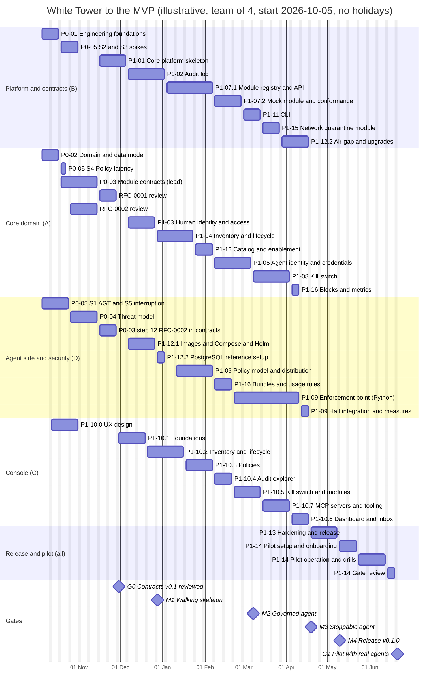

# White Tower: implementation roadmap to the MVP

| | |
| --- | --- |
| **Status** | Draft v0.2, open for review |
| **Date** | 2026-09-28; updated 2026-09-29 (ADR-0011; network quarantine adds one week) and 2026-10-19 (RFC-0002: the MCP servers, tools and models of agents add two weeks) |
| **Related** | [Requirements](requirements/mvp-requirements.md), [Architecture](architecture/mvp-architecture.md), [ADRs](adr/README.md), [Implementation plans](plans/README.md) |

This roadmap puts the implementation plans in order: who does what, when, and which milestones prove progress, from an empty repository to the MVP (the Phase 1 gate). The charter leaves phases undated until the team is known. Durations are therefore given in weeks under a stated staffing assumption, and the calendar dates are illustrative.

---

## 1. At a glance

- **Two phases to the MVP.** Phase 0, Foundations: 8 weeks. Phase 1, Core MVP: 29 weeks, including 6 weeks of pilot.
- **Effort.** About 101 person-weeks for the individual plans, plus joint hardening and pilot work, roughly 126 person-weeks in total.
- **Calendar with four people: 37 weeks** from start to the Phase 1 gate, before holidays and contingency. Starting on Monday 2026-10-05, the illustrative dates are:
  - Phase 0 gate at the end of November 2026;
  - release v0.1.0 in early May 2027;
  - Phase 1 gate in mid-June 2027.

  With the year-end break and a 15 to 20% contingency, plan for **August 2027**.
- **Critical path.** Since RFC-0002 brought the MCP servers, tools and models of agents into the MVP (two weeks more), three tracks end in the same week, before hardening and the pilot: the platform track (core skeleton → audit log → module API → CLI → network quarantine → air-gap and upgrades), the agent track (human identity → inventory → policies, and the catalog and enablement, which end the same week → bundles and usage rules → enforcement point) and the console. Only the second half of the core domain track (agent identity → kill switch → blocks) has a week of slack (section 6).
- **Two reviews to start now,** because they can delay everything: RFC-0001's external review and RFC-0002's review. The tag `contracts/v0.1.0` waits for both. The parts of plans that build on RFC-0002's contract changes also wait for P0-03 step 12, which lands those changes once RFC-0002 is accepted. The pilot partner is signed and the spikes are done: the AGT spike was a no-go, and White Tower builds its own enforcement point ([ADR-0011](adr/0011-own-python-enforcement-point.md)).
- **Progress (2026-09-30).** P0-02 and P0-05 are done, and P0-01 is done but for testing the development environment on macOS and Linux. P0-04 is done too, and P0-03 waits for the external review of RFC-0001. The ten founding ADRs are accepted, the Phase 1 team is confirmed, and the pilot environment is ready. The dates are re-baselined at G0 (section 11).
- **Progress (2026-10-19).** P1-01, P1-02 and P1-03 are done, and P1-12 has its images, Compose profile and Helm chart, well ahead of the illustrative calendar: coding agents implement the plans part by part, and a reviewer judges each part ([AGENTS.md](../AGENTS.md)). RFC-0002 brings the MCP servers, tools and models of agents into the MVP: P0-03 gains step 12, and plan P1-16 and console subplan P1-10.7 are new. Its review is not open yet, and RFC-0001's external review is pending. The dates are re-baselined at M2.

## 2. Assumptions

**Baseline team**

| Person | Workstream | Main plans |
| --- | --- | --- |
| A: backend lead (Go) | Core domain | P0-02, P0-03 (lead), P1-03, P1-04, P1-16 (catalog, enablement and blocks), P1-05, P1-08 |
| B: backend engineer (Go) | Platform and contracts | P0-01, P0-05 S2 and S3, P1-01, P1-02, P1-07 (with its RFC-0002 parts), P1-11, P1-15, P1-12.2 (steps 5 to 10) |
| C: frontend engineer (TypeScript) | Console | P1-10.0 to P1-10.7 |
| D: platform and security engineer (Go and Python) | Agent side, deployment and security | P0-05 S1 and S5, P0-04, P0-03 step 12, P1-12.1 and P1-12.2 step 4, P1-06, P1-16 (bundles and usage rules), P1-09, P1-13 (lead) |

Part-time roles:

- A maintainer acting as product lead: runs the RFC process, secures the pilot partner, and works with committee members.
- An independent security reviewer, for P0-04 and P1-13.

**Other assumptions**

- One week is five working days of one person. Durations sit within the plan sizes of the [plans index](plans/README.md).
- The pilot partner is signed (2026-09-30), and the details of the pilot are settled in P1-14.
- The AGT spike decided "no-go" ([ADR-0011](adr/0011-own-python-enforcement-point.md)). It adds no time: the spike showed that an adapter on AGT would have needed the same components as White Tower's own enforcement point.
- Week W1 starts on Monday 2026-10-05 in the illustrative calendar. Holidays are not modeled.

## 3. Milestones and gates

Every milestone ends with a recorded demonstration, a video or a script anyone can rerun, so progress is visible to the community.

| Milestone | Week (illustrative date) | What can be demonstrated | Plans done |
| --- | --- | --- | --- |
| **G0: Contracts v0.1 reviewed** (end of Phase 0) | W8 (2026-11-27) | The design package: accepted contracts (RFC-0001 and RFC-0002), data model, threat model, measured NFR targets, pilot partner signed | P0-01 to P0-05 |
| **M1: Walking skeleton** | W12 (2026-12-25) | The core deployed with Compose and Helm; login through Keycloak with each role; audit events sealed and verified; the console shell | P1-01, P1-03, P1-12.1, the audit writer and sealer of P1-02 |
| **M2: Governed agent** | W22 (2027-03-05) | An agent goes from proposal to active through the API and the console, gets tokens, and its approved policies reach a mock enforcement point as signed bundles; the tooling that the mock enforcement point reports enters the catalog, and is enabled for the agent through the API; decisions land in the audit log | P1-02, P1-04, P1-05, P1-06, P1-07, and the catalog, enablement and tooling reports of P1-16 |
| **M3: Stoppable agent** | W28 (2027-04-16) | Real agents on two frameworks governed by White Tower's enforcement point, using only the tooling enabled for them; one agent and then the fleet halted from the console and confirmed live within targets, with the agent's pods quarantined on kind; a block issued from the console reaching every enforcement point within NFR-24; conformance kit green | P1-08, P1-09, P1-15, P1-16, P1-10.1 to P1-10.5, P1-10.7 |
| **M4: Release v0.1.0** | W31 (2027-05-07) | A hardened, load-tested, signed release that installs air-gapped | P1-10, P1-11, P1-12, P1-13 |
| **G1: Pilot with real agents** (end of Phase 1: the MVP) | W37 (2027-06-18) | The five MVP criteria met in the pilot, with evidence | P1-14 |

## 4. Timeline

The same schedule as a table:

| Weeks | A: core domain | B: platform and contracts | C: console | D: agent side, deployment, security |
| --- | --- | --- | --- | --- |
| W1–W2 | P0-02 data model | P0-01 foundations | Console skeleton (P0-01), then P1-10.0 UX design (W2–W4) | P0-05 S1 AGT spike |
| W3–W6 | P0-03 contracts (lead); S4 in W3; RFC-0002 review (W4–W6) | S2 and S3 spikes (W3–W4); P0-03 protobuf and events (W5–W6) | UX design validated with prospective users | S1 and S5 (to W3); P0-04 threat model (W4–W6) |
| W7–W8 | RFC-0001 review; P1-03 preparation | P1-01 skeleton (W7–W9) | Design system on generated mocks | RFC-0002 in the contracts (P0-03 step 12) |
| W9–W12 | P1-03 human identity (W10–W12) | P1-01 (W9); P1-02 audit log (W10–W13) | P1-10.1 foundations (W9–W11); P1-10.2 begins (W12) | Security test automation (W9); P1-12.1 images, Compose, Helm (W10–W12) |
| W13–W16 | P1-04 inventory and lifecycle | P1-02 (W13); P1-07.1 module registry and API (W14–W18) | P1-10.2 inventory screens (to W15); P1-10.3 policies (W16–W18) | P1-12.2 PostgreSQL reference setup (W13); P1-06 policies (W15–W18) |
| W17–W20 | P1-16 catalog, enablement and tooling reports (W17–W18); P1-05 agent identity (W19–W22) | P1-07.1 (to W18); P1-07.2 mock module, conformance kit, load test (W19–W21) | P1-10.3 (to W18); P1-10.4 audit explorer (W19–W20) | P1-06 (to W18); P1-16 bundles and usage rules (W19–W20) |
| W21–W28 | P1-05 (to W22); P1-08 kill switch (W23–W26); P1-16 blocks and metrics (W27); P1-13 preparation (W28) | P1-07.2 (to W21); P1-11 CLI (W22–W23); P1-15 network quarantine (W24–W25); P1-12.2 upgrades, backups and the compatibility matrix (W26–W27), then its catalog flows: air-gap, egress-denied test, operations guides (W28) | P1-10.5 kill switch and modules (W21–W23); P1-10.7 MCP servers and tooling (W24–W26); P1-10.6 dashboard and inbox (W27–W28) | P1-09 enforcement point (W21–W27); halt integration and measurements (W28) |
| W29–W31 | P1-13 hardening and release v0.1.0 (everyone, led by D) | | | |
| W32–W37 | P1-14 pilot: setup, onboarding, operation, drills, gate review (everyone) | | | |

The free week in track D (W14) is deliberate: it absorbs part of the year-end break. Spike S1 finished before W1, which frees the weeks it had reserved.

## 5. How the phases unfold

**Phase 0 (W1–W8): decide before building.** The spikes, the data model and the foundations start on day one, in parallel. The contracts follow the data model; the threat model follows the first spike. RFC-0002 is reviewed in weeks 4 to 6, and P0-03 step 12 lands it in the contracts in weeks 7 and 8. The RFC review of the contracts runs in weeks 7 and 8 too, and the core skeleton starts at the same time, because it does not depend on the contracts. The contracts are tagged at G0, after both reviews and step 12. The console's UX design is validated with prospective users while nothing can be built yet.

**Phase 1, first half (W9–W22): a governed agent.** The core gains its audit log, logins and roles, then the inventory, the catalog of MCP servers, tools and models, agent credentials, policies and the module API. Every step is shown in the console as soon as its API exists: the console works against mocks generated from the OpenAPI document and never waits for the backend. **M2** proves the whole chain with the mock enforcement point.

**Phase 1, second half (W23–W31): a stoppable agent, then a release.** The kill switch and the enforcement point meet in week 28 (**M3**), with real agents using only their enabled tooling, stopped from the console and, on Kubernetes, isolated at the network level by the quarantine module. Deployment gains high availability, air-gap and upgrades. Three weeks of joint hardening produce v0.1.0 (**M4**).

**Pilot (W32–W37): prove it with real people.** Installation at the partner, onboarding of real agents through their real committees, operation, drills, evidence in the partner's SIEM, and the gate review (**G1**).

## 6. Critical path and where time can be won

**The critical path** runs through three tracks since RFC-0002 joined the MVP: the platform track, the console and the agent track all end in week 28.

> Platform: P0-01 → P1-01 → P1-02 → P1-07 → P1-11 → P1-15 → P1-12.2 → P1-13 → P1-14
>
> Console: P1-10.1 → P1-10.2 → P1-10.3 → P1-10.4 → P1-10.5 → P1-10.7 → P1-10.6 → P1-13 → P1-14
>
> Agent side: P0-01 → P1-01 → P1-03 → P1-04 → P1-06, and P1-16 (catalog, enablement and tooling reports), both ending in week 18 → P1-16 (bundles and usage rules) → P1-09 → P1-13 → P1-14

P1-07 now takes eight weeks, and so does P1-09 with its halt integration: both are XL, split into subplans. Track A (P1-03 → P1-04 → P1-16 catalog, enablement and tooling reports → P1-05 → P1-08 → P1-16 blocks and metrics) ends in week 27, one week earlier; its first part, up to P1-16's catalog, enablement and tooling reports, is on the agent side's critical path, so only P1-05 → P1-08 → P1-16 blocks has that week of slack. The contracts branch has slack: P0-03 step 12 lands RFC-0002 in the contracts in weeks 7 and 8, and the first plan that needs it, P1-07, starts in week 14. No track has more than one week of slack at the end.

**Where time can be won**

1. **A fifth person (Go)** can take P1-16 and P1-15. The backend tracks then end by week 26, and the console sets the pace: with P1-10.6's Should items (UI-08, UI-09) moved to v0.1.x, it ends about then too, since only its settings screens remain, and G1 comes about week 35 or 36. Without that move, the console still ends in week 28, and the fifth person saves no time.
2. **Run P0-03 step 12 as soon as RFC-0002 is accepted,** before the tag `contracts/v0.1.0`. The parts of plans that build on RFC-0002's contract changes wait for it, and after the tag, the changes that are not additive would need a `v1alpha2` (RFC-0002, Compatibility and versioning).
3. **Prepare the pilot during P1-13:** environment, IdP integration and SIEM export ready before the release.
4. **Keep the console on generated mocks,** so it never waits for the backend.

**What must not be cut:** the drills in the pilot, the tamper and fail-closed tests, and the external review of the contracts before they leave alpha. They are what makes White Tower trustworthy.

## 7. Scaling the team

| Team | Calendar to G1 (no holidays or contingency) | Comment |
| --- | --- | --- |
| 2 people (full stack: Go and TypeScript) | about 62 weeks (14 months) | Almost everything becomes sequential and the console is the bottleneck. Consider a thinner console for the pilot, relying on the CLI for operators. |
| 3 people (A, B and D; console shared) | about 47 weeks (11 months) | The console is built by B and D after their backend plans; UX design still happens early. |
| **4 people (baseline)** | **37 weeks (8 to 9 months)** | As scheduled above. |
| 5 people (a fifth on P1-16 and P1-15) | about 35 weeks (8 months) | Section 6, item 1: only with the console's Should items in v0.1.x. |
| 6 people | about 32 weeks (7 to 8 months) | The critical path dominates. Extra people add more quality (tests, documentation, a second framework in the enforcement point) than speed. |

## 8. Schedule risks

| Risk | Effect | Response |
| --- | --- | --- |
| The enforcement point (ADR-0011) needs hooks for more frameworks than planned | Track D gains 1 to 2 weeks per extra framework, which also needs hooks for exposure and provider-run tools (RFC-0002) | Start with LangGraph 1.x; choose the pilot's agents accordingly; more P1-09 subplans if more than two frameworks |
| A pilot framework cannot change the tools of a model request (EP-17) | The enforcement point cannot hide the tools that are not enabled from that framework's models, so their model calls are denied: track D must wrap the framework, or the pilot must use another one | Check each pilot framework's hooks when P1-09 starts (for LangGraph 1.x, P1-09 uses LangChain's middleware); choose the pilot's agents accordingly |
| The pilot's cluster cannot enforce deny rules, or the pilot runs on Docker | Network quarantine cannot be shown in the pilot | Agree on the environment in the pilot agreement; show it on the reference cluster at M3 and in P1-13 |
| The pilot partner withdraws | G1 slips week for week | Keep the partner involved through the milestones; fall back to the maintainers' own organizations |
| RFC-0001 needs a second round | P1-07 and P1-09 move by up to 2 weeks, partly absorbed by slack | Share drafts from week 4; invite external reviewers at the start |
| RFC-0002 is not accepted in time (at least two weeks of review, with an external reviewer) | P0-03 step 12 waits, and with it the tag `contracts/v0.1.0` and everything built on RFC-0002: the RFC-0002 parts of P1-06, P1-07 and P1-09, and P1-16's bundles, usage rules and blocks, on the critical path | Announce it at once, together with RFC-0001's pending external review; the rest of those plans, and P1-16's first three pull requests, do not need it |
| Year-end break (W12–W13 in the illustrative calendar) | About 2 weeks | Plan it; track D has one free week (W14) |
| The console (XL) slips | M3 and M4 slip | API first, generated mocks, early UX design; the Should items (UI-08, UI-09) can move to v0.1.x |
| One person per critical track (B, C and D, with A close behind) | Illness or departure delays everything | Pair reviews across tracks (B on P1-05 and P1-08, A on P1-07 and P1-15); keep designs written down |
| Spikes miss NFR targets | Architecture rework (for example the hash chain fallback for the audit log, or a broker) | Spikes in weeks 1 to 4, with fallbacks already named in the ADRs |

## 9. Gate checklists

### G0: "Contracts v0.1 reviewed" (end of Phase 0)

- [x] ADR-0001 to ADR-0010 accepted or amended: accepted by the maintainer (2026-09-30); ADR-0011 was accepted before.
- [x] Requirements v0.2: NFR targets set from measurements (P0-05); open questions Q1 to Q6 closed (2026-09-30).
- [x] Data model v0.1 and lifecycle specification approved (P0-02, 2026-09-29).
- [ ] RFC-0001 and RFC-0002 accepted, provisionally by the maintainer while the project has no external reviewer ([GOVERNANCE.md](../GOVERNANCE.md#rfc-process)); RFC-0002 in the contracts (P0-03 step 12); then the tag `contracts/v0.1.0` (P0-03), so that RFC-0002's changes that are not additive need no `v1alpha2` (RFC-0002, Compatibility and versioning). RFC-0001 was approved by the maintainer (2026-09-30), and the maintainer decided every point of its review on 2026-10-22; RFC-0002's review follows RFC-0001's acceptance.
- [x] Threat model v0.1 reviewed by the security reviewer (P0-04): reviewed and accepted by the maintainer (2026-09-30); an external review is planned before the pilot (P1-13).
- [x] Go or no-go on AGT recorded: no-go, White Tower builds its own enforcement point (P0-05 S1, ADR-0011).
- [ ] CI, release pipeline and development environment working on the three operating systems (P0-01). CI runs on every pull request; the release pipeline is deferred to the MVP (maintainer, 2026-09-30); the development environment still has to be tested on macOS and Linux.
- [x] Pilot partner signed (P1-14 step 1), which also closes Q7: the maintainer has the pilot environment ready (2026-09-30); its details are settled in P1-14.
- [x] Phase 1 team confirmed (2026-09-30). Only then do the dates of this roadmap become commitments.

### G1: "Pilot with real agents" (end of Phase 1, the MVP)

- [ ] Every pilot agent in the inventory with an active owner, a validated use case and an approved agent-specific policy.
- [ ] Governed agents authenticated by White Tower and governed at runtime by White Tower's enforcement point with White Tower policies.
- [ ] Pilot agents governed by White Tower's enforcement point using only the MCP servers, tools and models enabled for them: the rest denied and hidden from their models, and the usage rules of their policies applied (CAT, P1-16).
- [ ] Evidence in the tamper-evident log, verified with the CLI and exported to the partner's SIEM, including a consistency check against a checkpoint held by the SIEM.
- [ ] Halts of one agent and of the fleet confirmed and measured within the Phase 0 targets; the partition drill failed closed; on Kubernetes, the halted agents' pods quarantined (KIL-10).
- [ ] A block applied in the pilot, and measured reaching every enforcement point within NFR-24 (CAT-04).
- [ ] Microsoft AGT re-tested live, with the result recorded for Phase 2 (P1-14, ADR-0011).
- [ ] Release v0.1.x signed and verifiable; no open critical or high finding.
- [ ] Gate report approved by the maintainers and the pilot sponsor, with Phase 2 priorities.

## 10. After the MVP

The charter's later phases, not scheduled yet. Their plans are written during the pilot (W32–W37), so work can start right after G1.

| Phase | Content | Gate |
| --- | --- | --- |
| **2: Key modules** | LLM gateway and quotas; MCP network gateway for agents without the enforcement point, built on the MVP's catalog, blocks and usage rules (RFC-0002); stateful usage rules (sequences of calls, counts per task, data flowing between tools); enforced per-agent harness (including stopping workloads, on top of the MVP's network quarantine). The skills repository is no longer planned: usage rules take its place (decision of 2026-10-13). Also: a second policy engine to prove module replacement, per-task delegated tokens, strict mode for critical agents, a TypeScript enforcement point, and an interoperability adapter for Microsoft AGT. | One use case in production |
| **3: Ecosystem** | Shadow AI discovery; compliance module and GRC export; public third-party module SDK; public release; hosting in a foundation. | First third-party module |

The order of the Phase 2 modules is decided at G1 from what the pilot shows, for example whether the MCP gateway or the LLM gateway matters more to the first adopters.

## 11. Keeping the roadmap current

- The [plans index](plans/README.md) is the source of truth for plan status; this roadmap is reviewed at every milestone.
- After each gate, re-baseline the dates and record the variance and its causes.
- Dates become commitments only once the team is confirmed at G0, as the charter says.
